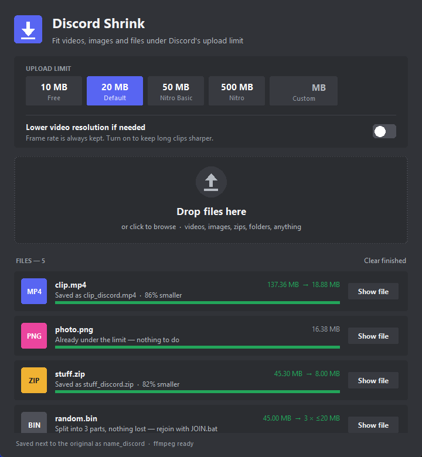

# Discord Shrink

Get videos, images, zips and other files under Discord's upload limit without wrecking the quality.



## Download and set up (Windows)

1. Click the green **Code** button above, then **Download ZIP**. Or grab the zip from [Releases](../../releases).
2. Unzip it anywhere.
3. Double-click **`Setup.bat`** once. It installs Python, Pillow and ffmpeg if you don't already have them.
4. Double-click **`Discord Shrink.bat`** to open the app.

## How to use it

- Pick an upload limit: **10 MB** (free Discord), **50 MB** (Nitro Basic), **500 MB** (Nitro), or type your own.
- Drop files or folders onto the window, or click the drop zone to browse.
- The shrunk copy is saved **next to the original** as `name_discord.ext`. Your original file is never touched.

You can also drag files straight onto `Discord Shrink.bat` to skip the window.

## What it does to each file

| File | What happens | Quality |
|---|---|---|
| **Videos** (mp4, mov, mkv, webm…) | Two-pass H.264 encode aimed at exactly the size limit. Keeps the **original frame rate and resolution**, like SteelSeries Moments. Turn on *Lower video resolution if needed* to keep long clips sharper. | As good as the size allows |
| **Images** (png, jpg, webp, gif…) | Highest JPEG quality that fits, or WebP for images with transparency. PNGs stay lossless when they already fit. Only shrinks the picture as a last resort. | Usually indistinguishable from the original |
| **Zips, folders, anything else** | Repacked with maximum compression. If it's still too big, split into parts that each fit, plus a `JOIN.bat` that puts them back together. | Lossless: nothing is lost |

**Tips**

- Long videos at a small limit get soft in fast motion. Trim them, or turn on the resolution option.
- To rejoin split parts, put them all in one folder and run `JOIN.bat`. 7-Zip can also open the `.001` file directly.

## Command line

```
python discord_shrink.py --limit 10 video.mp4 photo.png stuff.zip
python discord_shrink.py --downscale long_clip.mp4
```

## License

MIT
